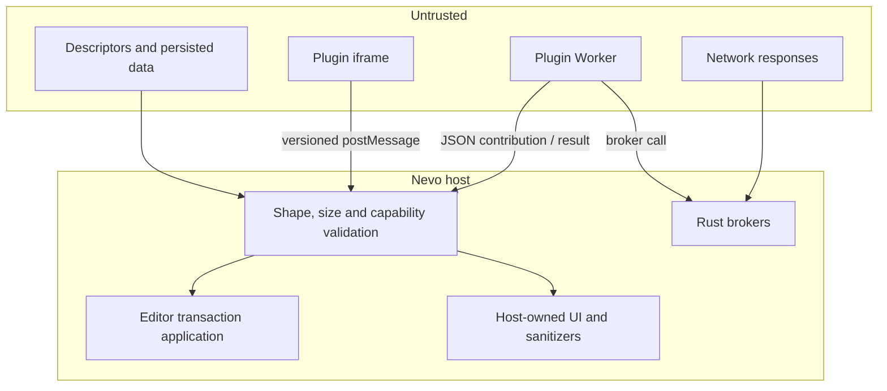

# Plugin SDK V2: security model

SDK V2 assumes that marketplace plugin code, descriptors, network data,
persisted attrs, and iframe messages are untrusted. Capabilities are part of
enforcement, not just text in the install dialog.

Trusted SDK V1 runs in the main WebView and has no such boundary. New
marketplace plugins must therefore use V2.

## Trust boundary



The host validates data at every boundary crossing. A successful manifest
check does not make subsequent messages trusted.

## Worker isolation

The Worker does not get:

- the DOM and host page;
- the Tauri API and arbitrary IPC commands;
- the filesystem;
- direct `fetch`, XHR, WebSocket, WebTransport, or EventSource;
- IndexedDB, Cache Storage, and the cookie store;
- nested Worker/SharedWorker and BroadcastChannel;
- direct `setTimeout`/`setInterval`;
- navigation, notifications, and WebRTC.

The entry module is loaded via an opaque `nevoplugin` token, canonically bound
to a single plugin directory. Relative imports stay inside that directory;
absolute paths, `..`, and cross-plugin access are rejected. Each module or
static file served by a code session is limited to 5 MiB.

## RPC validation

The Worker protocol checks:

- protocol version `2.0`;
- request ID and session token;
- known message type;
- plain JSON shape;
- message size up to 1 MiB;
- handler timeout of 5 seconds;
- lifecycle/migration timeout of 10 seconds;
- liveness of the sandbox event loop.

JSON values cannot contain functions, class instances, cycles, `NaN`, or
infinite numbers. A contribution definition is limited to 200 registrations.

A timeout sends a cancel request and aborts the handler signal. A Worker that
crashes or blocks the event loop is restarted once. A repeated fatal failure
puts the plugin into session quarantine without changing the persisted
`enabled`.

Retrying an invocation after a restart means the handler must be idempotent
until the moment the result is returned.

## Editor isolation

The plugin receives a snapshot, not ProseMirror objects. The host:

- includes the full `doc` only with `editor.read`;
- accepts mutations only with `editor.write`;
- limits an intent to 100 operations;
- validates positions and schema types;
- rejects absolute positions with a stale revision;
- applies all operations in one transaction or none at all.

Tier 2 `editor.write.self` is narrower still: a frame can patch only the attrs
of its own live node. The patch is limited to 256 KiB and goes through
JSON/schema validation again.

## Declarative UI

The host UI DSL:

- uses an allow-list of elements and attributes;
- escapes attrs bindings;
- allows at most one `contentSlot`, only as the sole child of an element, and
  requires an element at the UI root;
- forbids inline style, external URLs, and DOM callbacks.

Plugin CSS is scoped by plugin ID and limited to 64 KiB. `@import`,
`@font-face`, `url()`, global selectors, and root element selectors are
forbidden.

Tier 1 SVG goes through a sanitizer that removes:

- `script`, `foreignObject`, `style`;
- `on*` event attributes;
- external `url()` and `href`;
- other active-content constructs.

Static host UI remains the fallback if the render handler is unavailable.

## Iframe isolation

A workspace view, modal, and Tier 2 block run with:

```html
sandbox="allow-scripts"
```

Without `allow-same-origin`, navigation, popup, form submission, and direct
network. `referrerpolicy="no-referrer"`. The CSP forbids connections, nested
frames, objects, and base navigation; scripts and static files are loaded only
from the plugin-scoped code session.

The bridge:

- accepts messages only from the specific iframe window;
- checks the protocol version and message type;
- limits the payload to 256 KiB;
- passes only locale/theme/node attrs and versioned events;
- does not pass secrets or host objects.

The frame delegates privileged work to the Worker via a validated `invoke`. The
handler ID is opaque and valid only within the current plugin session.

## Storage and path isolation

Workspace storage:

```text
.nevo/plugin-data/<pluginId>.json
```

Assets:

```text
.nevo/plugin-assets/<pluginId>/<sha256>
```

Local storage gets an app-data namespace with the workspace fingerprint and
plugin ID. Plugin ID, storage keys, asset IDs, upload IDs, and relative paths
are validated as single safe components. Canonical path checks prevent
traversal, symlink escape, and cross-plugin access.

Storage quotas:

- 256 KiB per JSON value;
- 5 MiB per storage scope;
- 512 KiB per single-shot asset;
- 8 MiB per chunked asset;
- 64 MiB per asset scope;
- up to eight concurrent uploads.

The `nevoplugin-asset` token is bound to the asset root of a single plugin. The
protocol serves only images with recognized magic bytes; SVG/HTML and arbitrary
binary do not become renderable content.

## Secrets

`settingsSchema` with `secret: true` saves the value to the secure store.
`api.secrets.get()`:

- requires `secrets.read`;
- is available only to the Worker;
- uses the plugin namespace;
- does not pass the value to the iframe.

The plugin itself is responsible for not returning the secret as a handler
result, not writing it to attrs/storage, and not including it in an error
message.

## Network security

The Rust broker re-reads the installed manifest on each request and checks:

- plugin ID and V2 execution mode;
- the `network.fetch` capability;
- HTTPS without username/password;
- exact/wildcard host policy;
- method allow-list;
- safe request headers;
- DNS addresses before connect;
- every redirect against the same rules;
- response size during streaming.

Private, loopback, link-local, multicast, documentation, and other non-public
addresses are rejected, including IPv4-mapped IPv6. Verified DNS addresses are
pinned in the HTTP client, closing the DNS rebinding window.

Cookies and browser credentials are not used. `Authorization`,
`Proxy-Authorization`, `Cookie`, `Host`, connection, and `sec-*` headers are
forbidden. The redirect limit is five, the timeout is 30 seconds, and the body
limit is 5 MiB.

A network response is still untrusted: the plugin must validate the JSON shape,
not insert raw HTML/SVG, and not turn server fields into command IDs.

## Marketplace transaction

Install/update uses a prepared transaction root:

1. the package is downloaded into a separate staging directory;
2. the manifest, paths, and permission fingerprint are verified;
3. the staged Worker is started only via a temporary code session;
4. contributions and migrations are verified before publication;
5. the live editor saves the Y.Doc and releases the old Worker;
6. the plugin directory, storage, registry, and affected Y.Docs are journaled;
7. the new version is published atomically.

Staged code does not see the installed plugin directory. Commit re-checks the
fingerprint and installed version to rule out a race between confirmation and
publication.

An unfinished `committing` journal is rolled back on the next marketplace call.
A `committed` journal is only cleaned up.

## Persisted schema fallback

The last valid schema is saved in:

```text
.nevo/plugin-registry.json
```

If a plugin is disabled, missing, or broken, the host loads the schema without
executing code. This preserves attrs and rich children in the Y.Doc. The export
fallback adds a safe JSON marker and must not lose nested content.

The fallback does not replace migration compatibility. Renaming a node/mark/attrs
without a data migration still breaks the persisted contract.

## DOCX serializers

A DOCX serializer returns only data: the host validates the fragment (limits on
the number of blocks, rows, cells, and text size, link schemes http/https/mailto,
relative asset paths without `..`, SVG via `sanitizeSvg`) and assembles the
Nevo blocks itself. The plugin gets no access to the network or filesystem
through this path; an invalid fragment is discarded entirely.

## Plugin author responsibilities

- Request minimal capabilities.
- Validate handler input and network responses.
- Escape SVG/XML, even if the host additionally sanitizes the result.
- Do not include secrets in results, logs, or persisted JSON.
- Bound your own collections and recursion.
- React to `AbortSignal`.
- Make handlers safe for a single retry.
- Do not keep authoritative state only in the iframe DOM.
- Preserve schema names/attrs or write sequential migrations.
- Test the disabled/missing plugin and the export fallback.

## Security review checklist

- [ ] Every capability is used.
- [ ] The network policy is no wider than the necessary hosts/methods.
- [ ] No raw HTML/SVG from the network without your own validation/escaping.
- [ ] No secret leakage in errors, attrs, storage, or the iframe.
- [ ] The handler survives a repeated invocation.
- [ ] Absolute editor positions are used only when necessary.
- [ ] Storage keys and collection sizes are bounded.
- [ ] Large binary data is stored via assets.
- [ ] The frame works read-only without `editor.write.self`.
- [ ] The migration was checked on a copy of a legacy Y.Doc.
