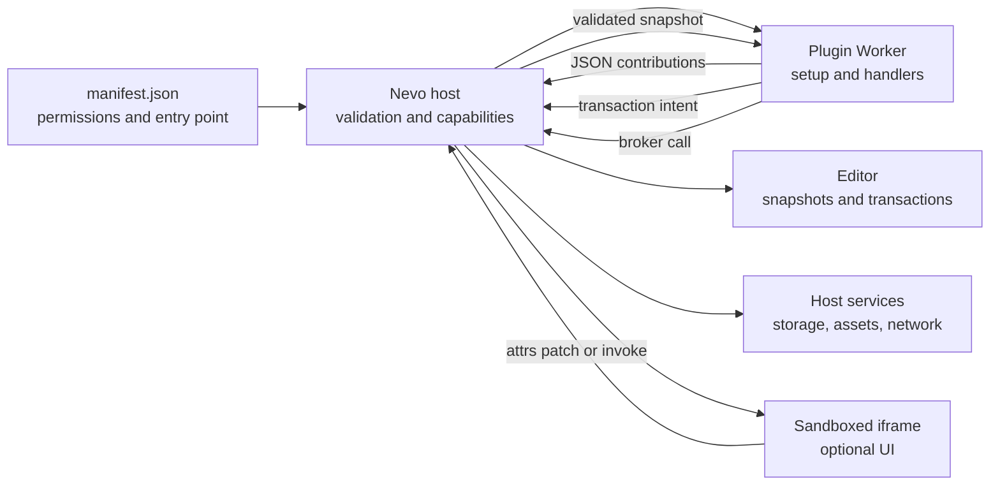

# Nevo Plugin SDK V2

The Plugin SDK lets you extend the Nevo editor and workspace without access to
internal Vue, ProseMirror, or Tauri objects. A marketplace plugin runs in an
isolated Worker, describes its interface with JSON descriptors, and asks the
host to perform permitted operations through a capability-gated API.

> This documentation applies to `@nevo/plugin-sdk` 2.x and
> `executionMode: "sandboxed-worker"`. Trusted SDK V1 is needed only for
> compatibility with bundled/system, folder, and already installed legacy
> plugins. New marketplace plugins must use SDK V2.

## Where to start

If you are writing your first plugin, read the pages in this order:

1. [Quickstart and manifest](./plugin-sdk/quickstart.md) — create, build, and
   install a minimal plugin.
2. [Contributions and lifecycle](./plugin-sdk/contributions.md) — add
   commands, menus, schema, serializers, and events.
3. [Working with the editor](./plugin-sdk/editor.md) — read snapshots and return
   atomic transaction intents.
4. [UI and custom blocks](./plugin-sdk/ui.md) — choose host UI, safe SVG, or a
   sandboxed iframe.
5. [Host services](./plugin-sdk/services.md) — storage, settings, secrets,
   assets, network, scheduling, and workspace commands.
6. [Testing and debugging](./plugin-sdk/testing.md) — unit tests, conformance,
   manual checks, and common mistakes.
7. [Localization](./plugin-sdk/localization.md) — ship translations, localized
   settings and READMEs, and use `api.i18n`.

Reference materials:

- [Capability reference](./plugin-capabilities.md)
- [Security model](./plugin-security.md)
- [Migration from SDK V1](./plugin-sdk-v2-migration.md)
- [Full Quick Date and Callout examples](../packages/plugin-sdk/examples)

## What you can extend

SDK V2 supports:

- editor commands, keymaps, slash items, and toolbar actions;
- schema nodes, marks, and custom block types;
- declarative popovers and decorations;
- Markdown, HTML, Typst, and DOCX serializers, as well as fenced-code importers;
- workspace views, sidebar items, and modals;
- the `transactionApplied` event and host-managed scheduling;
- plugin-scoped settings, secrets, JSON storage, and binary assets;
- HTTPS requests to pre-declared hosts;
- allow-listed template and kanban commands.

A plugin cannot import Nevo internals, manipulate the editor DOM, send
arbitrary Tauri commands, or read workspace files. If a task does not fit the
published API, that is a limitation of the SDK, not a reason to bypass the
sandbox.

## Execution model



The sandbox boundary applies in both directions:

- the host passes a handler only JSON input, an editor snapshot, and an
  `AbortSignal`;
- a handler returns JSON, a string, `null`, or a transaction intent;
- the host re-checks the capability, structure, size, and freshness of the
  result;
- the DOM and privileged services stay on the host side;
- an iframe does not get the capability API and delegates privileged work to
  the Worker.

## Minimal plugin

`manifest.json` declares the permission to write to the editor:

```json
{
  "id": "acme.hello",
  "name": "Hello",
  "version": "1.0.0",
  "description": "Adds an insertion command.",
  "enabled": true,
  "kind": "marketplace",
  "source": "marketplace",
  "entryPoint": "index.js",
  "apiVersion": "2.0.0",
  "executionMode": "sandboxed-worker",
  "dataVersion": 1,
  "capabilities": ["editor.write"],
  "settingsSchema": []
}
```

The entry module registers a slash item. A contribution ID always starts with
`<pluginId>.`:

```ts
import { definePlugin, transaction } from '@nevo/plugin-sdk'

export default definePlugin({
  setup(api) {
    api.slashItem({
      id: `${api.pluginId}.insert-hello`,
      title: 'Insert hello',
      category: 'text',
      keywords: ['hello', 'greeting'],
    }, (_input, { editor }) => {
      if (!editor) throw new Error('Editor snapshot is required')

      return transaction(editor.revision, [{
        type: 'insertText',
        text: 'Hello from Nevo',
        from: 'selection.from',
        to: 'selection.to',
      }], { scrollIntoView: true })
    })
  },
})
```

`setup` runs when the Worker loads and only registers contributions. A user
action invokes the stored handler later. For more on the call order and the
permitted descriptors, see
[Contributions and lifecycle](./plugin-sdk/contributions.md).

Each plugin has its own page in Settings → Plugins, opened from its card in the
installed list or the marketplace catalog. The page shows the manifest details
(version, source, execution mode, devices, permissions, network policy), the
plugin's actions, and an optional top-level `README.md` rendered as plain
Markdown without links, images, or raw HTML. Fields from `settingsSchema` open
in a settings dialog from the card or the page.

## Public imports

The main entry point `@nevo/plugin-sdk` exports:

| Export | Purpose |
| --- | --- |
| `definePlugin()` | Declares the plugin definition |
| `transaction()` | Creates an editor transaction intent |
| `operations` | Short helpers for several common operations |
| `ui` | Builds a safe host UI tree |
| `defineBlockView()` | Starts the runtime inside a Tier 2 block iframe |
| Protocol types | `JsonValue`, snapshots, capabilities, operations, and contributions |
| Protocol constants | API/protocol versions and the main limits |

`@nevo/plugin-sdk/test-host` exports `createTestPluginHost()` for unit tests.
It emulates handler registration and invocation, but does not replace checks
against the real Nevo host.

## Core rules

1. Declare only the capabilities you need.
2. Use `api.pluginId` when building every contribution ID.
3. Pass only JSON-compatible data through the API: no functions, classes,
   `Date`, `Map`, circular references, or special numbers.
4. In editor handlers, use `editor.revision` from the received snapshot.
5. Prefer the `selection.from` and `selection.to` positions: they are safer
   when the document has changed.
6. Do not store binary data in node attrs or JSON storage — use
   `api.assets` and keep the `assetId` in the node.
7. Treat schema node names, mark names, attrs, and `dataVersion` as persisted
   API.
8. Handle cancellation via `signal` and stay within the handler limit.
9. Do not rely on the DOM, `fetch`, timers, or browser storage inside the
   Worker.
10. Test the plugin in light/dark theme, from the keyboard, and after
    disable/re-enable.

## Versions and compatibility

- SDK/API version: `2.0.0`;
- Worker protocol version: `2.0`;
- `apiVersion` compatibility is determined by the major version;
- `nevoVersionRange` supports an exact version, `^<major>`, `*`, and `latest`;
- `runtimes` (optional) lists the runtimes the plugin runs on — any of
  `desktop`, `android`, `ios`; omitted means all. On other runtimes the plugin
  is not loaded and cannot be installed or updated from the marketplace;
- a provided `runtimes` list must be non-empty, known, and duplicate-free, or
  the manifest is reported as invalid;
- `dataVersion` is a positive integer and changes only together with persisted
  data;
- changing capabilities or the network policy changes the permission
  fingerprint and requires new confirmation on a marketplace update.

Moving from V1 requires rewriting registrations and editor mutations, not just
changing the version number. Use the
[step-by-step migration guide](./plugin-sdk-v2-migration.md).
